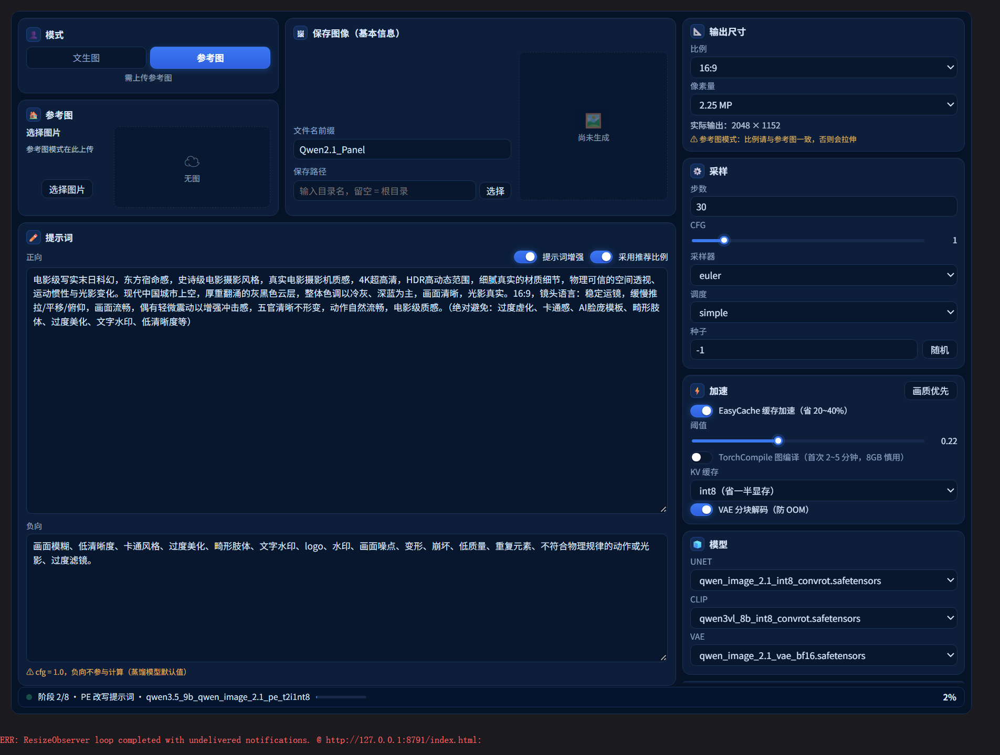
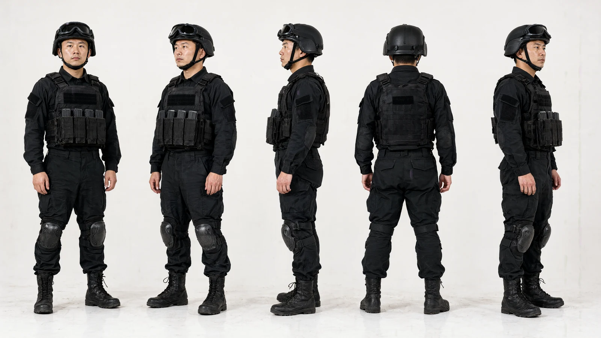
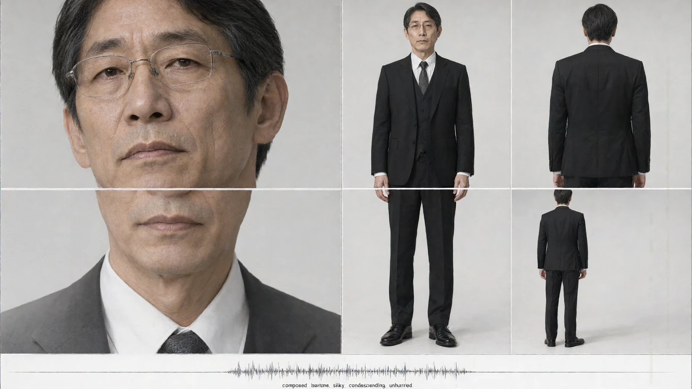

# Qwen 2.1 Director（ComfyUI 面板节点）

> 一个节点，一整条 Qwen-Image-2.1 生图链路，加一块填参数的面板。
>
> **English**: A single-node ComfyUI panel that wraps the entire Qwen-Image-2.1 pipeline (load → accelerate → encode → sample → decode → save) into one node with a real parameter UI. No node spaghetti, no hunting for a step count across eight nodes. Jump to [English Quick Start](#english-quick-start) · 中文文档见下。



把官方 Qwen-Image-2.1 的「加载 → 加速 → 编码 → 采样 → 解码 → 保存」全部收进**单个节点**：画布上不再是一排节点和一堆线，而是一块可以直接填参数的面板。出图后自动落盘，并把结果显示回面板里。

---

## 效果展示

以下图片均由本节点直接产出，未经修图或后期合成，仅做了尺寸缩放与格式转换（PNG → WebP）：

| 角色多视图 · 参考图模式 | 多角度细节一致性 |
|:---:|:---:|
|  |  |
| 一张参考图 → 同角色正/侧/背多视图，用于漫剧、短剧的角色设定 | 服装、装备、配饰在不同角度保持一致 |
| **电影感场景 · 文生图** | **多机位设定图 · 单张出图** |
|  |  |
| 纯提示词出图，湿地面反光、霓虹色溢、体积雾 | 一张图里并排近景、正面全身、背面，同一张脸、同一套西装保持统一 |

> 出图分辨率 2048×1152，25 步，加速预设开启。你可以直接用仓库里的[示例工作流](examples/Qwen21_Director_workflow.json)复现同类效果。
>
> 多机位图的原理是把「画面分栏 + 各栏机位」直接写进提示词，让模型在一张画布里一次排完；不是后期拼图，也不是多次生成再合成。想做真正的分镜序列，建议按镜头分别出图，再用「参考图模式」把同一个角色锁住。

---

## 目录

- [效果展示](#效果展示)
- [这个节点解决什么问题](#这个节点解决什么问题)
- [功能一览](#功能一览)
- [安装](#安装)
- [模型放置](#模型放置)
- [快速开始](#快速开始)
- [示例工作流](#示例工作流)
- [面板详解](#面板详解)
- [输出与落盘规则](#输出与落盘规则)
- [默认参数](#默认参数)
- [加速与显存](#加速与显存)
- [常见问题](#常见问题)
- [已知限制](#已知限制)
- [目录结构](#目录结构)
- [许可证](#许可证)

---

## 这个节点解决什么问题

官方 Qwen-Image-2.1 工作流是一串独立节点：loader ×3、加速链、文本编码、采样、解码、保存。参数散在七八个节点里，改一个步数要在节点树里翻半天，连线一多就看不清数据怎么走。

这个节点把它们包成**一层**，用面板当外壳：

| 传统连法 | 本节点 |
|---|---|
| 8～10 个节点、10 根以上连线 | 1 个节点、0 根线 |
| 参数分散在各节点 | 全部参数集中在面板 |
| 出图后还要接保存/预览节点 | 自己落盘 + 回填预览 |
| 不知道跑到哪一步 | 状态栏显示阶段名 + 整次任务百分比 |

**取舍要说清楚**：省掉的是自由度。如果你的工作流需要在 UNET 加载和解码之间插别的节点（换脸、ControlNet、外部 latent 处理），请直接用官方节点拆分搭建 —— 这个节点的定位是「一套参数跑到底」的出图台，不是通用积木。

三个 loader 口都保留了可选输入（`model` / `clip` / `vae`）：接上线就用你接的，不接就从面板下拉里加载。所以它既能当独立节点用，也能塞进已有工作流当「后半段」。

---

## 功能一览

| 分类 | 能力 |
|---|---|
| **两种模式** | 文生图 `t2i` / 参考图生图 `i2i`，面板上一键切换，切换时面板内容跟着变 |
| **提示词增强（PE）** | 内置官方 Qwen-Image-2.1-PE 改写器（Qwen3.5-VL 9B，int8）：短提示词 → 详细英文长提示词 + 推荐宽高比。跑完自动卸载权重，不与主模型抢显存；改写结果回填到提示词框，可手改 |
| **推荐比例** | 可让 PE 推荐的宽高比直接应用到输出尺寸 |
| **输出尺寸** | 比例预设 + 像素量（MP）两种定尺寸方式，实时显示实际输出宽高 |
| **采样参数** | 步数 / CFG / 采样器 / 调度器 / 种子（-1 = 每次随机） |
| **加速** | EasyCache 残差缓存（含阈值）、TorchCompile 图编译、KV cache 量化（int8 / default / int4）、VAE 分块解码，逐项独立开关 |
| **模型选择** | 面板内直接切换 UNET / CLIP / VAE，不用改节点树 |
| **保存** | 文件名前缀 + 输出子目录（可从已有目录列表里选），PNG 内嵌 prompt 与 workflow 元数据 |
| **进度** | 9 个阶段真实播报，底部状态栏按**各段实际耗时加权**算整次任务百分比 |
| **无依赖** | 除 ComfyUI 自带模块外，零第三方 pip 依赖 |

---

## 安装

### 环境要求

- **ComfyUI ≥ 0.30.0** —— 需要内置官方 Qwen-Image-2.1 节点，以及 `comfy_extras` 里的 `QwenImage21Cache`、`EasyCacheNode`（加速链用到；找不到时该段自动跳过，不影响出图）
- **Python ≥ 3.10**
- **无额外 pip 依赖**：代码只 import 标准库和 ComfyUI 自带的 `nodes` / `folder_paths` / `server`

### 步骤

```bash
cd ComfyUI/custom_nodes
git clone <本仓库地址> ComfyUI_Qwen21Director
```

重启 ComfyUI。在节点列表 `Qwen21` 分类下可以看到 **Qwen 2.1 Director（面板）**。

> 只改过前端界面（`web/js/`）时，不必重启，浏览器 `Ctrl+F5` 强制刷新即可；改过 `.py` 必须重启。

---

## 模型放置

仓库**不包含任何模型权重**，需要自己准备（合计约数十 GB，请按你的显存选量化版本）。

| 用途 | 文件名（默认值） | 放置目录 |
|---|---|---|
| UNET | `qwen_image_2.1_int8_convrot.safetensors` | `models/diffusion_models/` |
| 文本编码 CLIP | `qwen3vl_8b_int8_convrot.safetensors` | `models/text_encoders/` |
| VAE | `qwen_image_2.1_vae_bf16.safetensors` | `models/vae/` |
| PE 改写（文生图） | `qwen3.5_9b_qwen_image_2.1_pe_t2i.int8_convrot.safetensors` | `models/text_encoders/` |
| PE 改写（参考图生图） | `qwen3.5_9b_qwen_image_2.1_pe_i2i.int8_convrot.safetensors` | `models/text_encoders/` |

说明：

- 表里是**默认文件名**。实际文件名不同没关系，面板下拉框里选成你本地的那一个就行。
- 两个 PE 权重按 `t2i` / `i2i` 分开，是因为参考图模式的改写要「看着参考图改」，提示词策略不同。只跑文生图的话，装 `pe_t2i` 那一个就够。
- PE 权重通过 `CLIPLoader(type=qwen_image)` 加载，所以放 `text_encoders/`，不要放 `checkpoints/`。
- 权重请从 Qwen-Image-2.1 官方发布渠道获取，本仓库不提供下载与镜像。

---

## 快速开始

1. 新建节点 → `Qwen21` → **Qwen 2.1 Director（面板）**
2. 面板「模型」区确认 UNET / CLIP / VAE 三个下拉都指向你本地的文件
3. （可选）「模式」选**参考图**，点「选择图片」上传参考图
4. 写提示词。想要更细的画面就打开「提示词增强」（见下方说明，**这一项很慢**）
5. 「输出尺寸」选比例和像素量
6. Queue Prompt
7. 图会保存到 `output/<子目录>/<前缀>_00001_.png`，同时显示回面板

> **运行前先关掉 Ollama**（如果装了）。它会常驻显存，和这套模型抢，直接表现为 OOM 或速度骤降。

---

## 示例工作流

不想手动搭节点，直接用仓库里带的工作流：

[`examples/Qwen21_Director_workflow.json`](examples/Qwen21_Director_workflow.json)

**用法一（推荐）**：下载这个 json，在 ComfyUI 里把文件拖进画布，或顶部菜单 → Workflow → Open 打开即可。里面已经把面板节点、尺寸、采样、加速都配好了。

**用法二**：如果你装了 [ComfyUI Manager](https://github.com/ltdrdata/ComfyUI-Manager)，也可以在 Manager 的 Workflow 面板里导入。

打开后**第一件事**是检查「模型」区三个下拉（UNET / CLIP / VAE）指向的文件是否都存在 —— 工作流里存的是文件名，换了机器、文件名不一致时要重新选一次。

---

## 面板详解

面板分左右两栏。左栏是「生成什么」，右栏是「怎么生成」。窄窗口下会自动收成单列。

### 模式

- **文生图**：只用提示词出图
- **参考图**：需要一张参考图，从面板上传，或把图片节点接到节点的 `image` 输入口

切到参考图模式后，「参考图」卡片才会出现上传入口。没给图就运行会直接报错并提示 —— 不会静默退化成文生图。

### 参考图

「选择图片」上传 → 显示缩略图与文件名；「清除」移除。

这张图只在**参考图模式**下使用。上传的是文件名引用（存在 ComfyUI `input/` 下），不随工作流搬家，换机器要一起拷贝。

### 提示词

一个正向提示词框，支持多行。

**提示词增强（PE）** 打开后：

- 后端先用 9B 视觉语言模型把你的短句改写成一段详细的英文提示词
- 改写结果**回填到提示词框**，你可以继续手改；下一次运行时如果框里已有内容，以你写的为准
- 跑完立刻卸载 PE 权重，不会和 UNET + CLIP + VAE 同时占显存
- 因为它是 9B 模型，**改写一次通常 3～7 分钟**（8GB 显存还要 offload，更慢）。状态栏那段时间会显示 `PE 改写提示词` 并把右侧模型名换成 PE 权重名 —— 这不是卡死

「采用推荐比例」：勾上后，PE 推荐的宽高比会直接应用到「输出尺寸」。

> 负向提示词在面板状态里存在，但**默认 CFG = 1.0**。CFG ≤ 1.0 时负向分支在数学上不参与计算，写了也无效。真要压制某些内容，把 CFG 调到 **2～4**。

### 保存图像

- **文件名前缀**：默认 `Qwen21_Panel`，支持 ComfyUI 的 `%date%` 一类占位符
- **保存路径**：输出子目录。点「选择」会列出 `output/` 下已有的子目录（最多三级），也可以直接输入新名字；留空 = 根目录

### 输出尺寸

两种定尺寸方式：

| 方式 | 行为 |
|---|---|
| **比例 + 像素量** | 选 `1:1` / `16:9` / `9:16` 等预设，再填目标 MP；节点自动算出对齐后的宽高 |
| **固定宽高** | 直接指定宽 × 高 |

下方实时显示**实际输出分辨率**。注意这里显示的是节点真正会用的尺寸 —— 如果跟你的比例预期不一致（比如比例算出来需要裁剪），说明该比例在目标像素量下不能整除，调 MP 或换比例即可。

### 采样

| 参数 | 默认 | 说明 |
|---|---|---|
| 步数 | 25 | 常用 20～30；配合加速可降到 10～15 |
| CFG | 1.0 | 蒸馏模型的安全值。要负向提示词生效请调 2～4 |
| 采样器 | `euler` | 官方推荐 |
| 调度器 | `simple` | 官方推荐 |
| 种子 | -1 | -1 = 每次随机；填定值可复现 |

### 加速

四项独立开关，可以全开、全关，也可以只开其中一两个。

| 项 | 作用 | 建议 |
|---|---|---|
| **EasyCache** | 残差缓存，跳过相邻步的相似计算，省 20～40% | 默认开。阈值默认 0.22，调高更省但可能掉细节 |
| **TorchCompile** | 编译计算图，提速但首次编译要 2～5 分钟 | 12GB 以下显存慎开；同一张图反复出时才值得 |
| **KV 缓存** | `int8` 省一半显存 / `default` 无损 / `int4` 更省但误差明显 | 默认 `int8`。显存够就选 `default` |
| **VAE 分块解码** | 分块解码，防大图 OOM | 默认开。显存紧张时必开 |

面板会把「全部加速已关闭」和「已开启」两种状态分开显示 —— 画质优先的工作流关掉全部加速后，加速区会收成一行，点「启用加速」一键恢复默认组合。

### 模型

UNET / CLIP / VAE 三个下拉，直接读取对应 `models/` 目录下的文件列表。换了马上生效，不用重连节点。

### 使用说明

右栏底部固定显示三条关键提示（提示词增强的耗时、负向提示词与 CFG 的关系、运行前关 Ollama）。这三条是**最容易踩的坑**，所以常显不折叠。

### 底部状态栏

```
● 阶段 2/8 · PE 改写提示词 · qwen3.5_9b_..._t2i_int8        36%
```

- **圆点**：灰色=待命，绿色闪烁=运行中，绿色常亮=完成，黄色=出错
- **阶段**：`读取参考图 → PE 改写提示词 → 加载 UNET/CLIP/VAE → 装配加速链 → 文本编码 → 准备画布 → 采样 → VAE 解码 → 保存落盘`，本次不会跑的阶段（比如没开 PE）不占编号
- **右侧百分比**：**整次任务**的进度，不是某一阶段的步数
- 悬停可看完整模型名与该阶段在做什么

百分比是按**各段典型耗时加权**算的，不是 `当前段 / 总段数`。原因很直接：PE 那段 3～7 分钟，读参考图只要 1 秒，等分会让读数长时间钉在 12% 不动，看着像死了。采样段有真实步数就用真实步数插值，其余段按「已用时 / 该段典型耗时」缓慢爬行并封顶 95%，只有真正完成才显示 100%。

---

## 输出与落盘规则

- 最终图片保存到 `output/<保存路径>/<文件名前缀>_00001_.png`
- PNG 内嵌 prompt 与 workflow 元数据，拖回 ComfyUI 可以还原本次参数
- 保存用的是 ComfyUI 内置 `SaveImage` 的同一套逻辑，文件名占位符、子目录、序号规则都一致
- **画布上这个节点没有输出口**（`RETURN_TYPES = ()`，`OUTPUT_NODE = True`）。这是刻意的：结果直接落盘并回填面板，面板即终点，不需要再拖一个保存节点
- 想把结果接到下游节点处理，请看官方 Qwen-Image-2.1 节点拆分方案

---

## 默认参数

```
模式            文生图
尺寸            1:1 · 1.0 MP
步数 / CFG      25 / 1.0
采样器 / 调度器  euler / simple
种子            -1（随机）
EasyCache       开，阈值 0.22
TorchCompile    关
KV 缓存         int8
VAE 分块解码    开
提示词增强      关
文件名前缀      Qwen21_Panel
```

---

## 加速与显存

经验值，按实际硬件调整：

| 显存 | 建议配置 |
|---|---|
| 8 GB | EasyCache 开 + KV `int8` + VAE 分块开；TorchCompile 关；PE 阶段会 offload，做好等 5 分钟以上的准备 |
| 12～16 GB | 上面基础上可开 TorchCompile；跑完一次后再出第二张更划算 |
| 24 GB+ | KV 换 `default` 保画质；其余按需 |

**PE 是独立的一次性开销**：它加载时主模型还没加载，跑完就卸载。所以开 PE 不会让峰值显存翻倍，只是总时长增加。

---

## 常见问题

**Q：点了 Queue 之后一直显示「PE 改写提示词」，是不是卡住了？**
不是。9B 模型改写一次 3～7 分钟是正常的，8GB 显存要 offload 会更慢。状态栏此时显示的是 PE 权重名，不是主模型。不想等就关掉「提示词增强」。

**Q：负向提示词写了没用。**
CFG = 1.0 时负向分支不参与计算。调到 2～4 才会生效，代价是出图风格可能变化。

**Q：找不到节点 / 启动时报 import 错误。**
先确认 ComfyUI ≥ 0.30.0 且已内置官方 Qwen-Image-2.1 节点。加速链依赖 `comfy_extras` 里的相关节点，缺了会自动跳过，但如果连基础 loader 都没有，节点不会注册。

**Q：报「参考图生图模式需要一张参考图」。**
切到了参考图模式但没给图。上传一张，或者把模式切回文生图。

**Q：出图很慢 / 直接 OOM。**
按顺序查：① 关 Ollama ② 开 VAE 分块解码 ③ KV 缓存换 `int8` ④ 降像素量 ⑤ 关 TorchCompile（首次编译很吃显存）。

**Q：换模型后要重连节点吗？**
不用。面板下拉直接切换，下一个任务生效。

**Q：图存哪了？**
`output/<保存路径>/<前缀>_00001_.png`。保存路径留空就是 `output/` 根目录。

**Q：界面颜色能跟随 ComfyUI 主题吗？**
不能。面板是自绘 DOM，配色写死在主题常量里（深色）。要换色改 `web/js/qwen21_director.js` 顶部的 `THEME` 对象即可，所有控件都从它取值。

**Q：能一次出多张吗？**
当前一次队列出一张。要批量就多次 Queue，或在外层用 batch 方案。

---

## 已知限制

- **单图输出**：一次 Queue 一张，面板没有 batch size。
- **CFG = 1.0 时负向提示词无效**（模型特性，非 bug）。
- **PE 只有 t2i / i2i 两套权重**，没有其他变体。
- **配色不跟随 ComfyUI 主题**，固定深色。
- **参考图按文件名引用**（存于 `input/`），工作流换机器需一并拷贝图片。
- **面板状态存在节点的 `panel` 字符串里**，不要手改这个 widget；要改参数请用界面。

---

## 目录结构

```
ComfyUI_Qwen21Director/
├── __init__.py              节点注册
├── pyproject.toml           包元信息（ComfyUI Registry 用）
├── qwen21_director.py       后端：加载 / PE / 加速 / 采样 / 解码 / 保存 / 阶段播报
├── web/js/
│   └── qwen21_director.js   前端：整块面板（DOM 自绘 + 状态栏）
├── examples/
│   └── Qwen21_Director_workflow.json   开箱即用的示例工作流
├── docs/
│   ├── screenshot.png       面板截图
│   └── examples/            效果展示图（WebP）
├── LICENSE                  Apache-2.0
└── README.md
```

**前后端约定**：面板所有状态序列化成一个 JSON 字符串，放在节点的 `panel` widget 里传给后端；后端不信任它的结构，逐字段取值并带默认值兜底。后端通过 `qwen21/stage` 事件把阶段、进度区间、当前模型推给前端，前端只更新自己那个节点的状态栏。

---

## 许可证

[Apache License 2.0](LICENSE)

## 致谢

- [Comfy-Org / ComfyUI](https://github.com/comfyanonymous/ComfyUI) —— 官方 Qwen-Image-2.1 支持与加速节点
- Qwen 团队 —— Qwen-Image-2.1 模型与 PE 改写方案

---

## English Quick Start

**Qwen 2.1 Director** collapses the whole Qwen-Image-2.1 pipeline — loaders, acceleration, text encoding, sampling, decoding, saving — into **one ComfyUI node with a real panel UI**. Instead of 8–10 wired-up nodes, you get one node and a form. Output is written to disk and previewed back inside the panel.

### Requirements

- ComfyUI `>= 0.30.0` (with official Qwen-Image-2.1 support)
- The model weights below. Put them in these exact folders:

| Purpose | File | Folder |
|---|---|---|
| Diffusion model | `qwen_image_2.1_int8_convrot.safetensors` | `models/diffusion_models/` |
| Text encoder | `qwen3vl_8b_int8_convrot.safetensors` | `models/text_encoders/` |
| VAE | `qwen_image_2.1_vae_bf16.safetensors` | `models/vae/` |
| PE rewrite (t2i) | `qwen3.5_9b_qwen_image_2.1_pe_t2i.int8_convrot.safetensors` | `models/text_encoders/` |
| PE rewrite (i2i) | `qwen3.5_9b_qwen_image_2.1_pe_i2i.int8_convrot.safetensors` | `models/text_encoders/` |

These are the **default** filenames — if yours differ, just pick your file in the panel dropdowns. Only the `t2i` PE weight is needed if you never use reference-image mode. PE weights load through `CLIPLoader(type=qwen_image)`, so they belong in `text_encoders/`, **not** `checkpoints/`. Weights are not distributed here; get them from the official Qwen-Image-2.1 release.

### Install

```bash
cd ComfyUI/custom_nodes
git clone https://github.com/gaospony-stack/ComfyUI_Qwen21Director.git
```

Restart ComfyUI. The node appears as **Qwen 2.1 Director** under the `Qwen21` category.

### Use

1. Drag [`examples/Qwen21_Director_workflow.json`](examples/Qwen21_Director_workflow.json) into the canvas — everything is pre-wired.
2. Verify the three dropdowns under **模型 / Model** (UNET / CLIP / VAE) point at files you actually have.
3. Type a prompt. Optionally enable **提示词增强 / Prompt Enhance** — this runs a 9B rewrite model and takes **3–7 minutes**; it is not hung.
4. Pick an aspect ratio and target megapixels under **输出尺寸 / Output Size**.
5. Queue Prompt. The image lands in `output/<subfolder>/` and shows up in the panel.

### Gotchas

- **Quit Ollama before running.** It holds VRAM permanently and fights this model — the symptom is an OOM or a sudden 10× slowdown.
- **Negative prompts do nothing.** The sampler runs at CFG 1.0, where the negative branch is mathematically cancelled out. Use the positive prompt and the PE rewrite instead.
- **The status bar percentage is time-weighted, not stage-count-based.** The PE rewrite legitimately occupies 60–80% of a typical run, so an even 1/8 per stage would sit still and look frozen.
- Without the optional models the node still runs — you just lose prompt enhancement.

Full Chinese documentation (panel walkthrough, acceleration presets, VRAM guidance, FAQ, known limitations) is above. Issues and PRs welcome.
